# Exp14c: MF + AdaM³ 联合学习率与裁剪阈值搜索
120 次内部验证搜索与 80 次正式训练均完成。优化器使用未偏差修正的一阶矩平方更新二阶矩，β=(0.9,0.999)，eps=1e-8，权重衰减为零。
准确率、标准差、区间及配对差均以百分点表示。区间采用跨 10 个种子的双侧 Student-t 95% 置信区间（df=9），未做多重比较校正。配对差为 AdaM³ − Exp9 Adam。
每次训练分别校准 ε=8、δ=1e-5；不对搜索、选参或重复训练整体声称 ε=8。历史官方评价数据已被使用，本实验不是新的盲测。
两组使用各自选定的超参数，因此比较反映各自调参协议下的整体表现，不能归因为优化器的孤立因果效应。

## CV

|机制|lr|C|AdaM³ 均值 ± SD|95% CI|Adam 均值|配对差|配对差 95% CI|
|---|---:|---:|---:|---|---:|---:|---|
|dp-adam-iid|0.00015|30|59.194 ± 1.487|[58.130, 60.258]|60.189|-0.995|[-1.326, -0.664]|
|dp-adam-sgd-bandinvmf|0.0002|30|73.057 ± 0.750|[72.520, 73.594]|70.223|+2.834|[+2.528, +3.140]|
|dp-adam-momentum-bandinvmf|0.0006|30|76.411 ± 0.610|[75.974, 76.848]|72.982|+3.429|[+3.089, +3.769]|
|dp-adam-momentum-bias-bandinvmf|0.0004|30|77.082 ± 0.434|[76.772, 77.392]|76.724|+0.358|[+0.152, +0.564]|

AdaM³ 正式均值最高的机制为 dp-adam-momentum-bias-bandinvmf（77.082%）；这只是冻结配置后的描述性比较，不用于重新选参。
- dp-adam-iid：相对 Adam 的配对差 -0.995 pp，区间全部低于零。
- dp-adam-sgd-bandinvmf：相对 Adam 的配对差 +2.834 pp，区间全部高于零。
- dp-adam-momentum-bandinvmf：相对 Adam 的配对差 +3.429 pp，区间全部高于零。
- dp-adam-momentum-bias-bandinvmf：相对 Adam 的配对差 +0.358 pp，区间全部高于零。
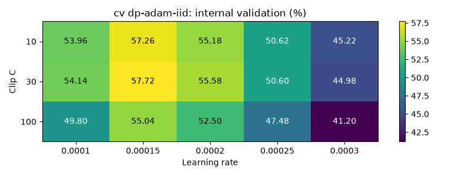
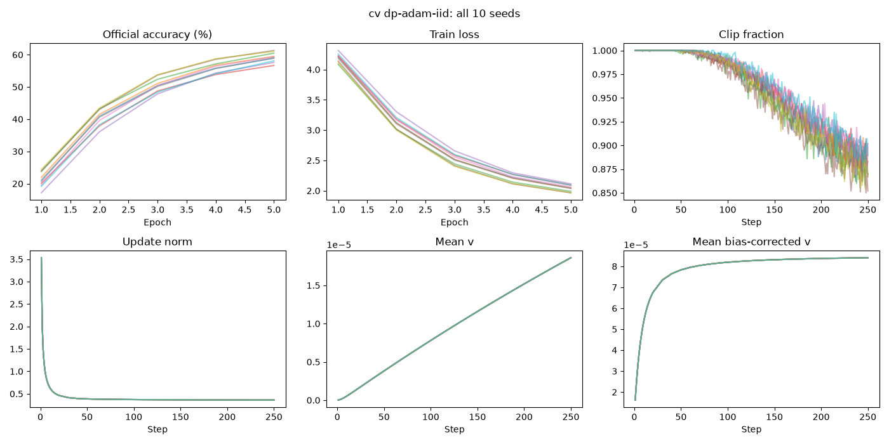
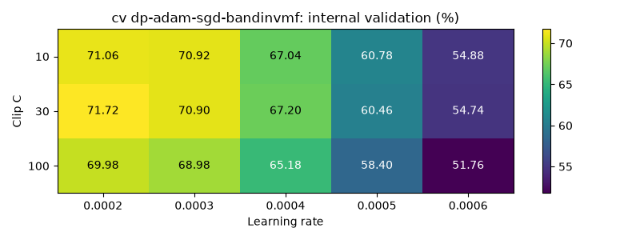
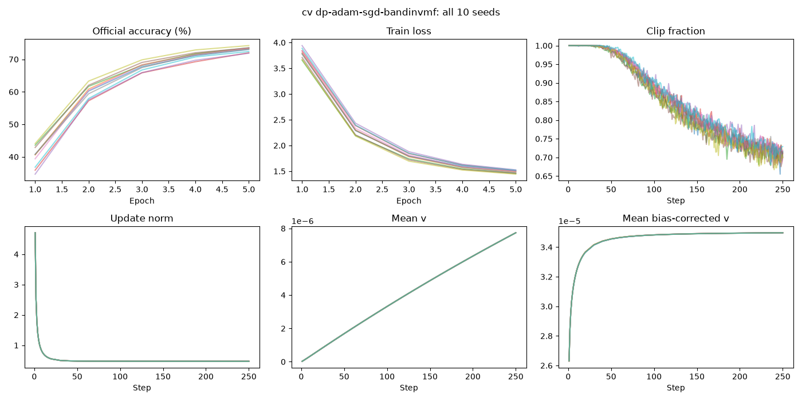
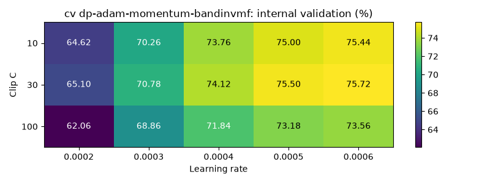
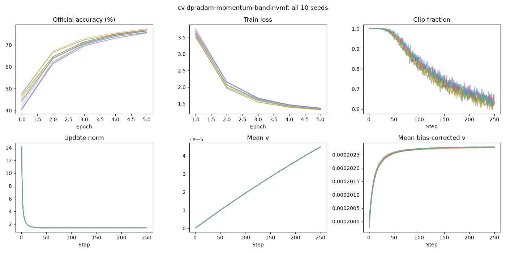
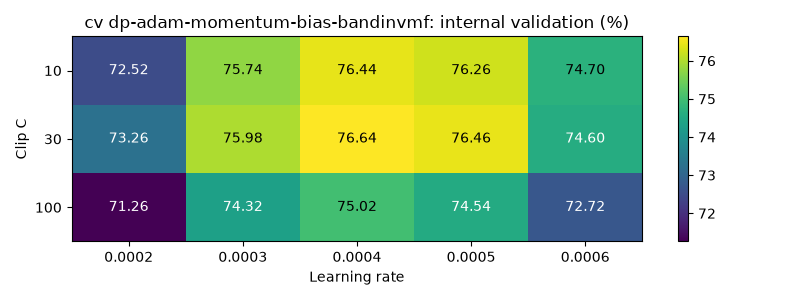
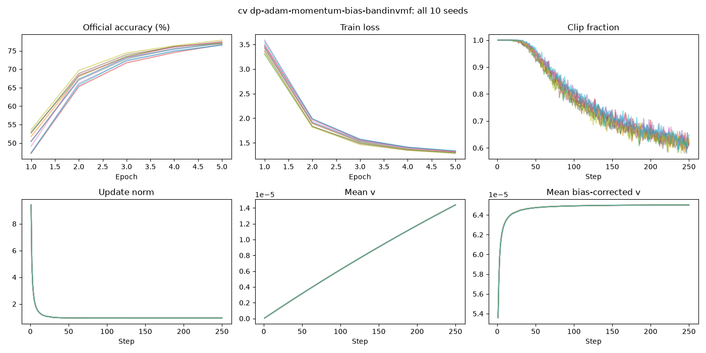

## NLP

|机制|lr|C|AdaM³ 均值 ± SD|95% CI|Adam 均值|配对差|配对差 95% CI|
|---|---:|---:|---:|---|---:|---:|---|
|dp-adam-iid|0.0003|0.3|76.388 ± 1.006|[75.668, 77.107]|75.986|+0.401|[-0.273, +1.076]|
|dp-adam-sgd-bandinvmf|0.0008|10|77.718 ± 1.022|[76.987, 78.449]|77.718|+0.000|[-0.429, +0.429]|
|dp-adam-momentum-bandinvmf|0.001|10|77.970 ± 0.910|[77.319, 78.621]|76.789|+1.181|[+0.283, +2.079]|
|dp-adam-momentum-bias-bandinvmf|0.001|20|78.601 ± 1.203|[77.740, 79.461]|77.936|+0.665|[-0.214, +1.544]|

AdaM³ 正式均值最高的机制为 dp-adam-momentum-bias-bandinvmf（78.601%）；这只是冻结配置后的描述性比较，不用于重新选参。
- dp-adam-iid：相对 Adam 的配对差 +0.401 pp，区间包含零。
- dp-adam-sgd-bandinvmf：相对 Adam 的配对差 +0.000 pp，区间包含零。
- dp-adam-momentum-bandinvmf：相对 Adam 的配对差 +1.181 pp，区间全部高于零。
- dp-adam-momentum-bias-bandinvmf：相对 Adam 的配对差 +0.665 pp，区间包含零。
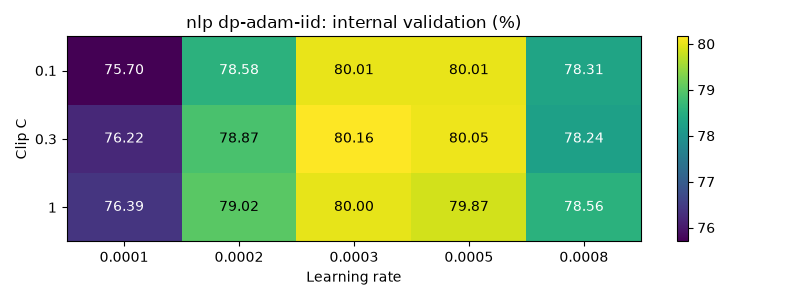
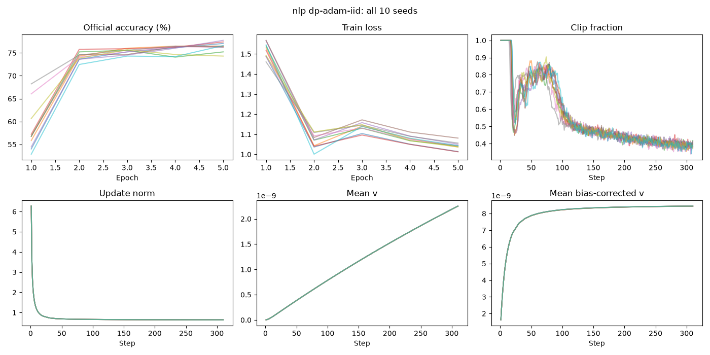
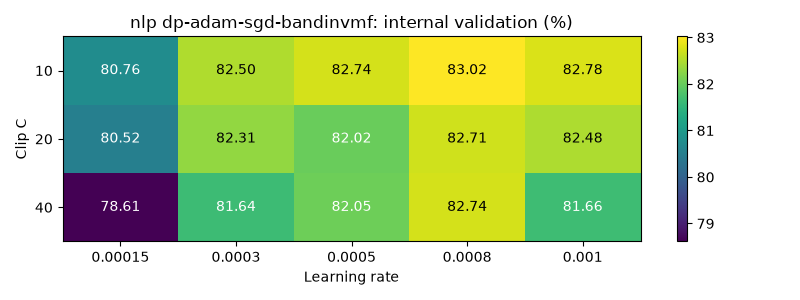
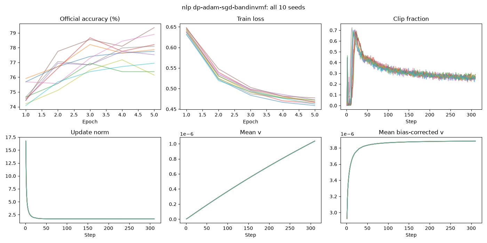
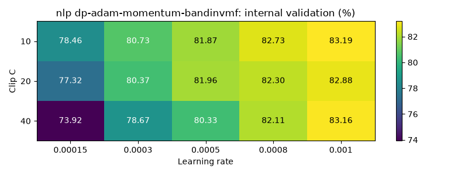
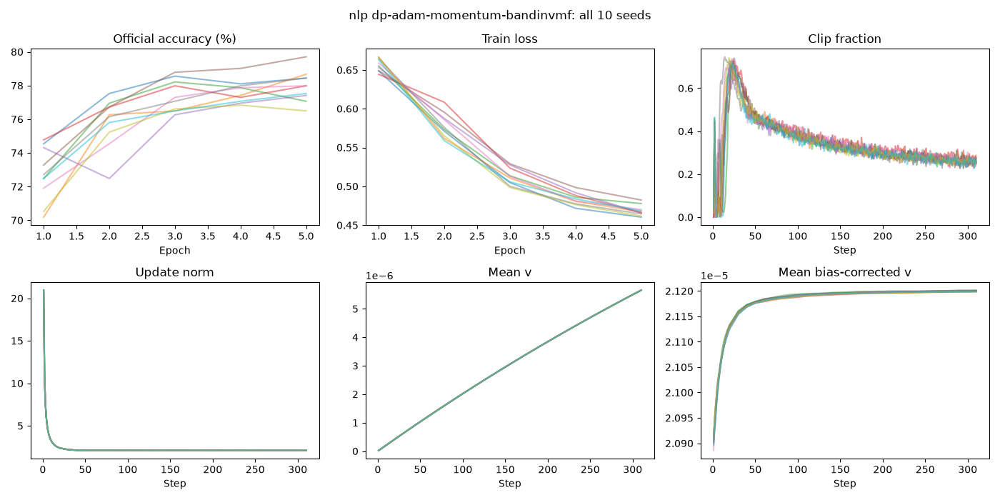
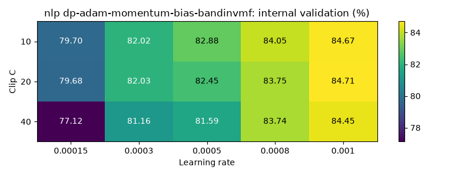
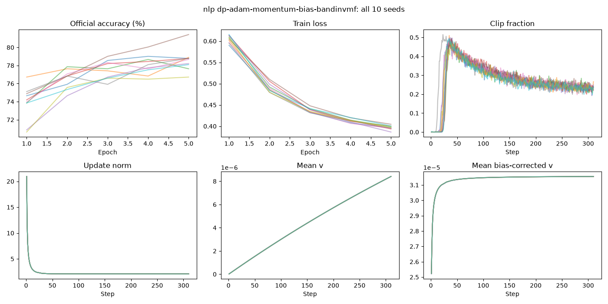

## 审计与证据

见 `audit.json`、`frozen_manifest.json`、`search_ranking.csv`、`statistics.csv`、`paired_differences.csv` 和 `scheduler.jsonl`。严格配对检查包括初始化、数据顺序、增强/Dropout 随机轨迹及 MF 矩阵；噪声创新生成器同 seed+1，噪声幅度随各自 C 校准。
CV 内部搜索 45,000/5,000，正式训练 50,000/10,000；NLP 内部搜索 62,000/5,349，正式训练使用同一 62,000 训练样本与官方 872 条评价样本。各次逐轮指标、裁剪比例、更新范数、二阶矩和检查点保存在对应 trial 目录。
