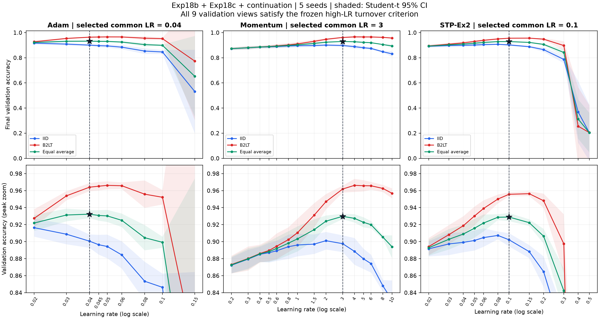

# Exp18c 继续搜索：所有优化器的高学习率转折

完成时间：2026-11-05T15:47:10.942279+08:00。

完成 3 轮扩展、180 次新增正式训练、12 次独立冒烟；结合 Exp18b/Exp18c 原有 180 次训练，在全部候选中共同选参。30 个最终检查点完成官方测试评价，其中 10 个复用原有同一检查点的测试结果，20 个进行新评价。

实验参数严格沿用 Exp18b/Exp18c：MNIST 54000/6000/10000，Exp18 CNN 11,274 参数，复用五份初始化，3 epoch/162 步、物理 batch 1000、FP32/禁用 TF32。裁剪 Adam=3、Momentum=4、STP-Ex2=100；STP 稳定系数 0.005。优化器与三份 B2LT 矩阵不变。每个 LR 都是 IID/B2LT 五种子，初始权重、排列和创新流配对；仅搜索 LR。

四张 GPU 自动检测编号与 UUID，按 UUID 绑定独立进程；每卡最多 12 个进程，保留 1536 MiB，每进程按 832 MiB 或更高冒烟实测预算安排。任务分配、利用率、显存与日志在 gpu_telemetry.csv、gpu_processes.jsonl、trials/。

隐私为每次完整训练 ε=3、δ=1e-5，GDP 校准且无采样放大；多次运行的组合预算不等于 ε=3。验证集视为公开；训练损失和裁剪曲线仅为内部审计记录。

转折判据在运行前冻结：每种优化器的 IID、B2LT、两者平均三条曲线，最高两个已测试 LR 都大于该视角最优 LR，且准确率均低于最优；最高 LR 至少下降 0.001（0.1 个百分点）。数值发散单独记录为失败端点，不虚构验证分数。此处判断的是观测到的高 LR 侧回落，不等价于证明全局最优、稳定平台或统计显著性。

| 优化器 | 最终共同 LR | IID 验证准确率 | B2LT 验证准确率 | 等权平均 | 两种噪声均已越过峰值 |
|---|---:|---:|---:|---:|---|
| adam | 0.04 | 0.900600 | 0.964000 | 0.932300 | 是 |
| momentum | 3 | 0.897633 | 0.961833 | 0.929733 | 是 |
| stpex2 | 0.1 | 0.902200 | 0.955667 | 0.928933 | 是 |

单独 IID/B2LT 的最优 LR 仅用于曲线分析，正式配置继续使用两种噪声等权平均的共同 LR。

| 优化器 | 视角 | 该视角最优 LR | 最优准确率 | 高端见证 LR | 对应准确率 | 最高 LR 回落（百分点） |
|---|---|---:|---:|---|---|---:|
| adam | iid | 0.02 | 0.916400 | 0.1, 0.15 | 0.846267, 0.531233 | 38.5167 |
| adam | b2lt | 0.05 | 0.966167 | 0.1, 0.15 | 0.952167, 0.773200 | 19.2967 |
| adam | average | 0.04 | 0.932300 | 0.1, 0.15 | 0.899217, 0.652217 | 28.0083 |
| momentum | iid | 2 | 0.901100 | 8, 10 | 0.848000, 0.831100 | 7.0000 |
| momentum | b2lt | 4 | 0.966200 | 8, 10 | 0.962567, 0.956800 | 0.9400 |
| momentum | average | 3 | 0.929733 | 8, 10 | 0.905283, 0.893950 | 3.5783 |
| stpex2 | iid | 0.08 | 0.907300 | 0.4, 0.5 | 0.368767, 0.204100 | 70.3200 |
| stpex2 | b2lt | 0.15 | 0.956367 | 0.4, 0.5 | 0.255233, 0.205367 | 75.1000 |
| stpex2 | average | 0.1 | 0.928933 | 0.4, 0.5 | 0.312000, 0.204733 | 72.4200 |

## 全部验证曲线与轮次

| 优化器 | LR | 来源 | IID | B2LT | 两者平均 |
|---|---:|---|---:|---:|---:|
| adam | 0.02 | exp18b | 0.916400 | 0.927433 | 0.921917 |
| adam | 0.03 | exp18b | 0.908733 | 0.953900 | 0.931317 |
| adam | 0.04 | exp18b | 0.900600 | 0.964000 | 0.932300 |
| adam | 0.045 | exp18c | 0.896333 | 0.965200 | 0.930767 |
| adam | 0.05 | exp18c | 0.894333 | 0.966167 | 0.930250 |
| adam | 0.06 | exp18c | 0.884400 | 0.965733 | 0.925067 |
| adam | 0.08 | exp18c/continuation | 0.853433 | 0.955800 | 0.904617 |
| adam | 0.1 | exp18c/continuation | 0.846267 | 0.952167 | 0.899217 |
| adam | 0.15 | exp18c/continuation | 0.531233 | 0.773200 | 0.652217 |
| momentum | 0.2 | exp18b | 0.872233 | 0.873067 | 0.872650 |
| momentum | 0.3 | exp18b | 0.879433 | 0.880167 | 0.879800 |
| momentum | 0.4 | exp18b | 0.885167 | 0.886033 | 0.885600 |
| momentum | 0.5 | exp18c | 0.887033 | 0.889600 | 0.888317 |
| momentum | 0.6 | exp18c | 0.889233 | 0.894567 | 0.891900 |
| momentum | 0.8 | exp18c | 0.894033 | 0.902333 | 0.898183 |
| momentum | 1 | exp18c/continuation | 0.896067 | 0.910567 | 0.903317 |
| momentum | 1.5 | exp18c/continuation | 0.897100 | 0.931100 | 0.914100 |
| momentum | 2 | exp18c/continuation | 0.901100 | 0.947033 | 0.924067 |
| momentum | 3 | exp18c/continuation | 0.897633 | 0.961833 | 0.929733 |
| momentum | 4 | exp18c/continuation | 0.888600 | 0.966200 | 0.927400 |
| momentum | 5 | exp18c/continuation | 0.879700 | 0.965733 | 0.922717 |
| momentum | 6 | exp18c/continuation | 0.874133 | 0.965667 | 0.919900 |
| momentum | 8 | exp18c/continuation | 0.848000 | 0.962567 | 0.905283 |
| momentum | 10 | exp18c/continuation | 0.831100 | 0.956800 | 0.893950 |
| stpex2 | 0.02 | exp18b | 0.891533 | 0.894167 | 0.892850 |
| stpex2 | 0.03 | exp18b | 0.897333 | 0.908233 | 0.902783 |
| stpex2 | 0.04 | exp18b | 0.899133 | 0.918700 | 0.908917 |
| stpex2 | 0.05 | exp18c | 0.901367 | 0.930100 | 0.915733 |
| stpex2 | 0.06 | exp18c | 0.904767 | 0.938967 | 0.921867 |
| stpex2 | 0.08 | exp18c | 0.907300 | 0.950067 | 0.928683 |
| stpex2 | 0.1 | exp18c/continuation | 0.902200 | 0.955667 | 0.928933 |
| stpex2 | 0.15 | exp18c/continuation | 0.888233 | 0.956367 | 0.922300 |
| stpex2 | 0.2 | exp18c/continuation | 0.864767 | 0.948100 | 0.906433 |
| stpex2 | 0.3 | exp18c/continuation | 0.787100 | 0.897400 | 0.842250 |
| stpex2 | 0.4 | exp18c/continuation | 0.368767 | 0.255233 | 0.312000 |
| stpex2 | 0.5 | exp18c/continuation | 0.204100 | 0.205367 | 0.204733 |

各轮不可变计划和冒烟验收见 rounds/。未使用官方测试集决定继续、停止或选择 LR；搜索全部结束后才冻结 best_hyperparameters.json 和 selection_freeze.json。

## 最终官方测试

五种子均值、样本标准差和 Student-t 95% CI（df=4），未校正选参或多重比较。

| 方法 | 共同 LR | 测试准确率 | SD | 95% CI | 测试损失 |
|---|---:|---:|---:|---|---:|
| adam-iid | 0.04 | 0.912700 | 0.009214 | [0.901259, 0.924141] | 0.758970 |
| adam-b2lt-sgd | 0.04 | 0.967140 | 0.001856 | [0.964836, 0.969444] | 0.143326 |
| momentum-iid | 3 | 0.905220 | 0.009287 | [0.893689, 0.916751] | 0.715541 |
| momentum-b2lt-momentum | 3 | 0.964880 | 0.002653 | [0.961586, 0.968174] | 0.149513 |
| stpex2-iid | 0.1 | 0.910640 | 0.007492 | [0.901338, 0.919942] | 0.427902 |
| stpex2-b2lt-momentum-bias | 0.1 | 0.961000 | 0.002255 | [0.958200, 0.963800] | 0.132976 |

逐种子验证、测试、耗时、显存及来源见 formal_per_seed.csv；完整统计见 summary.csv；B2LT − IID 配对差异见 paired_differences.csv。复用旧结果的路径与原始测试时间保留在 official_test/。

Exp18、Exp18b、Exp18c 原有文件及 data/ 保持只读，文件哈希核验见 readonly_verification.json。

## 验证集学习率曲线

上排显示完整准确率范围，下排放大峰值附近；虚线和星号为最终共同 LR。阴影为五种子 Student-t 95% CI，未校正选参或多重比较。平均曲线先对同一种子的 IID/B2LT 取均值后计算区间。
