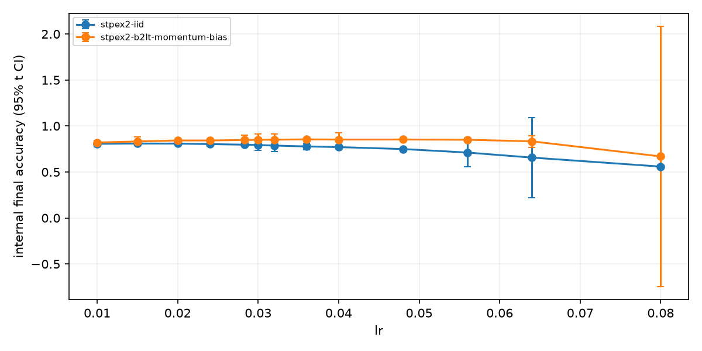
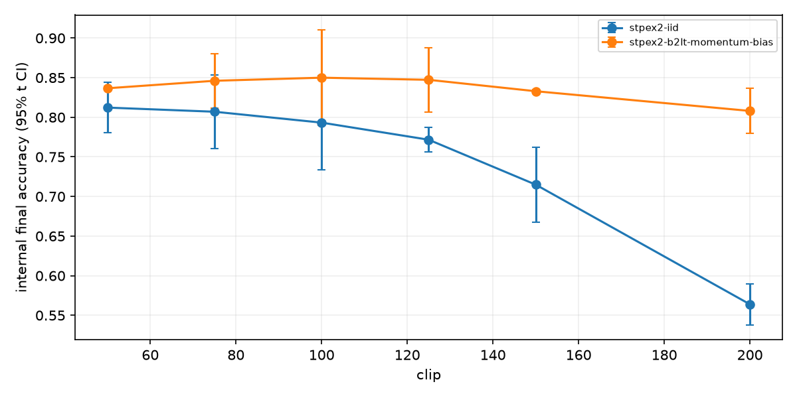
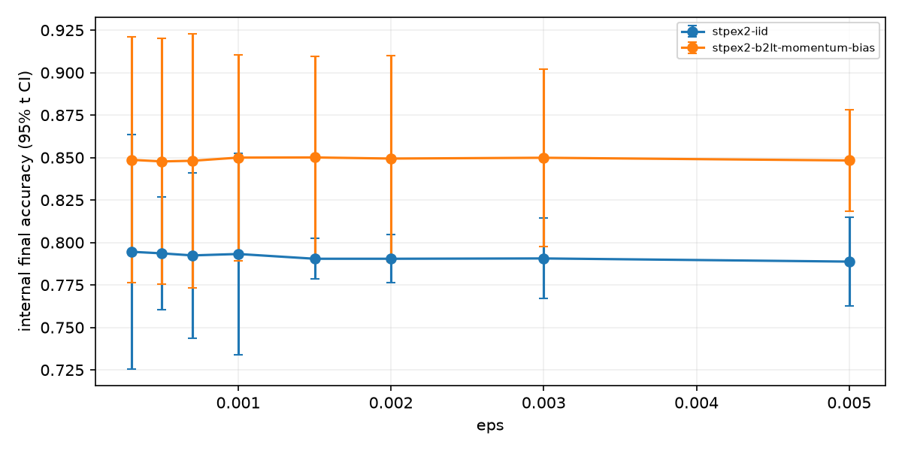
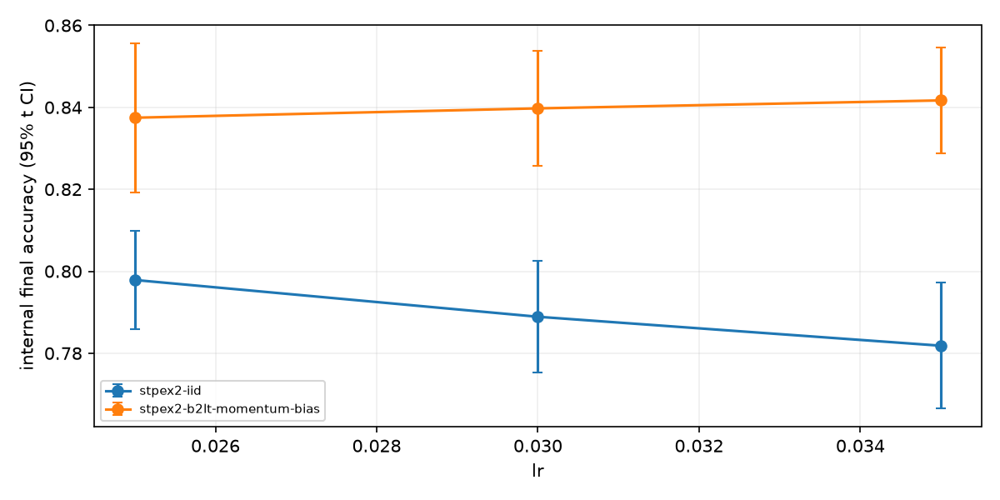

# Exp18f 实验报告

更新时间：2026-11-06T16:34:53.646355+08:00；流水线状态：complete；阶段：finished。
计划 156 次，完成 156 次，数值失败 0 次；总上限156次（另有6次3步冒烟测试）。

SST-2 / BERT-Tiny全参数微调；5×62=310步；逻辑和物理批次1000；长度128；FP32，TF32关闭。
直接读取Exp18e已有的62000训练/5349内部验证分词数据和固定划分；模型从cache/bert-tiny加载；全程离线，不读取官方验证集。
第一阶段27个轴条目（基准在三轴各保留一次）×2方法×2种子=108次；第二阶段至多3轮×6=18次；整齐参数3组×2方法×5全新种子=30次。
两方法使用相同超参数、初始化种子、排列及dropout顺序；每轮重复同一固定排列，无DDP。

## 转折点与冻结

学习率峰值：{'clip': 100, 'eps': 0.001, 'lr': 0.02}。
共同稳定性边界：{'coverage': 'bracketed', 'high_side_interval': {'high': 0.04893387250207109, 'low': 0.048}, 'intervals': [{'high': 0.04893387250207109, 'low': 0.048}], 'nonmonotonic': False}。
数值失败指NaN/Inf损失、梯度、优化器状态或模型参数；该任务终止，其他任务继续。有限值但准确率比基准低超过5个百分点或验证损失高于max(1.0,1.5×基准)标记为预测失稳；alpha衰减不判失败。
基准若无成功训练，预测失稳标签仅使用协议预先固定的绝对阈值；数值失稳始终单独记录。
出现失稳后再次稳定即视为非单调，改做局部几何中点加密，报告所有过渡区间；没有观测到两侧时保留删失结论。
冻结状态：frozen；最终共同参数：{'clip': 100, 'eps': 0.001, 'lr': 0.025}。
冻结只依据20261131–20261135五个新种子两方法的最终内部验证准确率均值，其次损失；不采用搜索阶段单次最高值。

## 五种子整齐参数复核

|候选|方法|完成/5|准确率均值|样本SD|95% t CI|
|---|---|---:|---:|---:|---|
|rounded_1|stpex2-iid|5/5|0.797869|0.009659|[0.785876, 0.809862]|
|rounded_1|stpex2-b2lt-momentum-bias|5/5|0.837465|0.014697|[0.819217, 0.855713]|
|rounded_2|stpex2-iid|5/5|0.788895|0.010948|[0.775302, 0.802489]|
|rounded_2|stpex2-b2lt-momentum-bias|5/5|0.839746|0.011318|[0.825692, 0.853799]|
|rounded_3|stpex2-iid|5/5|0.781828|0.012356|[0.766486, 0.797171]|
|rounded_3|stpex2-b2lt-momentum-bias|5/5|0.841690|0.010439|[0.828729, 0.854651]|

### 整齐参数与原始搜索最优的差异

|复核候选|方法|复核减原始最优准确率|95% Welch CI|
|---|---|---:|---|
|rounded_1|stpex2-iid|-0.009105|[-0.025006, 0.006797]|
|rounded_1|stpex2-b2lt-momentum-bias|-0.008581|[-0.026960, 0.009798]|
|rounded_2|stpex2-iid|-0.018078|[-0.034522, -0.001634]|
|rounded_2|stpex2-b2lt-momentum-bias|-0.006300|[-0.021075, 0.008474]|
|rounded_3|stpex2-iid|-0.025145|[-0.042509, -0.007781]|
|rounded_3|stpex2-b2lt-momentum-bias|-0.004356|[-0.018304, 0.009592]|

原始共同搜索最优：{'clip': 75, 'eps': 0.001, 'lr': 0.03}，候选ID=clip_01。

stpex2-b2lt-momentum-bias 的学习率性能峰值：{'candidate': 'lr_07', 'lr': 0.036, 'mean_accuracy': 0.8545522527575247}；预测与数值联合边界：{'coverage': 'bracketed', 'high_side_interval': {'high': 0.08, 'low': 0.064}, 'intervals': [{'high': 0.08, 'low': 0.064}], 'nonmonotonic': False}；纯数值边界：{'coverage': 'right_censored', 'high_side_interval': None, 'intervals': [], 'nonmonotonic': False}。

stpex2-iid 的学习率性能峰值：{'candidate': 'lr_01', 'lr': 0.015, 'mean_accuracy': 0.8096840530940362}；预测与数值联合边界：{'coverage': 'bracketed', 'high_side_interval': {'high': 0.04893387250207109, 'low': 0.048}, 'intervals': [{'high': 0.04893387250207109, 'low': 0.048}], 'nonmonotonic': False}；纯数值边界：{'coverage': 'right_censored', 'high_side_interval': None, 'intervals': [], 'nonmonotonic': False}。

样本SD使用ddof=1，95%区间使用Student-t；不足五种子结果标记为未完成。方法间差采用逐种子配对差；双方法总体均值以五个种子为五个观测单位。
整齐参数与原始搜索最优的差值及Welch区间保存于search/rounded_vs_raw.json。因种子不同且原始最优经过搜索选择，该比较仅作描述，不作为无偏优越性证据。

## 输出与隐私

search/{lr,clip,eps}_results.csv为完整轴结果；search/statistics.json包含准确率和损失的均值、样本SD及95% CI；search/rounded_results.csv为复核明细。
plots/下保存各候选两方法的逐种子损失（原始与10步平滑）、alpha和裁剪比例曲线，以及各轴与整齐参数准确率图；每个任务curve.json保存逐轮内部验证准确率和损失。
每次训练独立按实际clip和对应矩阵重新校准ε=8、δ=1e-5；固定零槽增删邻接，每样本参与5次、间隔62步；不使用抽样放大。
eps是优化器稳定系数，独立于隐私epsilon。搜索和复核的整体组合不具有ε=8保证；内部原始诊断不是DP发布。
三张GPU使用UUID隔离，动态显存准入；每卡至多2进程，全局至多6进程。logs/保存阶段状态、调度事件和GPU遥测；launch.json保存后台PID和启动命令。
基础设施故障停止当前阶段、终止同阶段工作进程并保留现场，不做静默重试。
